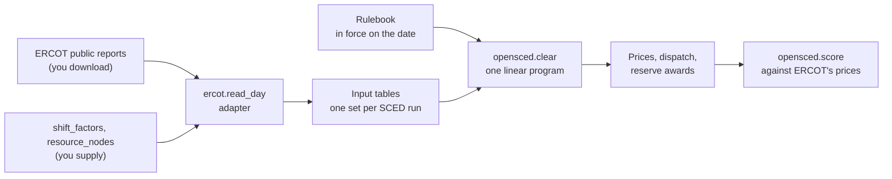

# opensced

An open market-clearing engine for power markets. Give it offers, limits, reserve demand and network constraints for
one dispatch interval, and it returns the system price, the price at every node, dispatch, reserve awards and reserve
prices.

The first market is **ERCOT's real-time market** (SCED with energy and ancillary services co-optimized, live since
December 5, 2025). Replayed on 34 operating days from December 11, 2025 to September 15, 2026, every SCED run of each
day, from ERCOT's public files:

| Test | Runs | System lambda within $1 of ERCOT | Node prices within $1 |
|---|---|---|---|
| The clearing alone: congestion taken from ERCOT's own node prices | 9,909 | 99.95% (5 runs miss) | not applicable |
| Full replay: shift factors fitted from the same day's public prices | 9,937 | 98.4% | 98.0% (99.8% within $5) |

The first row tests the engine's rules and math. The second adds the error of shift factors that ERCOT does not
publish and that the user must supply. The 34 days include days with system lambda up to $1,373 and 12 days the
engine had never been run on while it was built. The five misses and the weakest days are
listed in [Known differences](#known-differences).

**This repository is the engine only. It ships no market data.** You download ERCOT's public reports yourself;
[docs/data_flow.md](docs/data_flow.md) shows which report fills which input.

## Install

```bash
pip install opensced
```

Python 3.10 or later. It depends on numpy, pandas and scipy only.

## Five minutes, no data

```python
import opensced

case = opensced.examples.three_bus()     # a made-up grid: 3 nodes, 3 generators, a battery, one line
result = opensced.clear(case)
print(result)
```

```text
Clearing  [rules: custom]
  system lambda     $54.75 /MWh
  dispatched        250.0 MW across 2 resources
  constraints       1 of 1 binding; highest $82.92 on WEST-CITY
  node prices       $5.00 to $54.75 over 3 nodes
```

```python
result.node_prices()      # WEST 5.00, NORTH 38.17, CITY 54.75
result.dispatch           # MW per resource
result.shadow_prices      # $/MWh per constraint
```

Everything is a pandas object. Change an input and clear again:

```python
opensced.clear(case.copy(demand=300)).system_lambda
```

## A real ERCOT run

```python
ercot = opensced.market('ercot')
day = ercot.read_day('my_data/2026-08-12')                # your folder of ERCOT's public files for one day
inputs = day.inputs(day.times[0], shift_factors=my_shift_factors, resource_nodes=my_resource_nodes)

result = ercot.clear(inputs)                              # uses the rulebook in force that day
opensced.score(result, system_lambda=day.published_lambda()[day.times[0]],
               node_prices=day.published_node_prices().loc[day.times[0]])
```

A whole day:

```python
out = ercot.clear_day(day, shift_factors=my_shift_factors, resource_nodes=my_resource_nodes)
out.system_lambda      # time -> $/MWh
out.node_prices        # time x settlement point
opensced.score(out, system_lambda=day.published_lambda(), node_prices=day.published_node_prices())
```

A run of intervals, each starting where the last one ended:

```python
out = ercot.clear_day(day, shift_factors=sf, resource_nodes=nodes, carry=('output', 'ramp', 'soc'))
out = opensced.clear_sequence(list_of_inputs, rules)       # any market, any list of intervals
```

`carry` picks what the engine works out from the interval before instead of reading from each interval's tables:
each resource's starting output, how far its ramp rate lets it move, and each battery's state of charge.

Run the examples:

```bash
python examples/01_three_bus.py                          # the made-up grid, step by step: no data needed
python examples/02_ercot_one_run.py my_data/2026-08-12   # one real SCED run against ERCOT's published prices
python examples/03_what_if.py my_data/2026-08-12         # more demand, less solar, a changed rule
```

## How data feeds the engine



The full chart, with every ERCOT report and the table it fills, is in [docs/data_flow.md](docs/data_flow.md). The
input tables are defined column by column in [docs/schema.md](docs/schema.md).

## What you bring

A folder with one operating day of ERCOT's public reports ([docs/ercot.md](docs/ercot.md) names the files). ERCOT
publishes everything the clearing needs except two things:

| Input | What it is |
|---|---|
| `shift_factors` | A table, constraint x settlement point: MW of flow on the constraint per MW injected there |
| `resource_nodes` | Which settlement point each resource injects at |

This package does not ship either. Without them a run still clears, as one node with no network, which gets the
system price wrong by several dollars on a congested day. ERCOT posts its shift factors only to its secure Market
Information System; [docs/data_flow.md](docs/data_flow.md#shift-factors) explains how to use those, or how to fit
shift factors from public prices. To forecast instead of replay, you replace any other table with your own: demand,
offers, wind and solar limits, outages.

## The inputs

One interval is an `opensced.Inputs`: a handful of plain tables. `resources` and `demand` are required, the rest are
optional and switch features on.

| Table | One row per | Switches on |
|---|---|---|
| `resources` | Resource: limits, ramp range, current output | |
| `energy_offers` | Offer curve point | |
| `demand` | One number, MW | |
| `constraints`, `shift_factors`, `resource_nodes` | Constraint; constraint x node; resource | The network and node prices |
| `reserve_demand`, `reserve_limits`, `reserve_offers` | Demand curve point; resource and product; offer block | Reserves cleared with energy |
| `storage` | Battery: state of charge and its bounds | State-of-charge limits on reserves |

```python
print(opensced.schema())              # every table, column by column, with units
print(opensced.schema('resources'))   # one table
inputs.validate()                     # raises with the table and the row at fault
```

The full data dictionary is in [docs/schema.md](docs/schema.md). ERCOT's own calculations (dispatch limits from
ramp rates, proxy offers, constraint caps) are in `opensced.market('ercot').helpers`, for when you forecast the
underlying numbers instead of reading ERCOT's result.

## Markets and rule versions

A market is its public-file adapter plus a list of dated rulebooks. A rulebook holds the numbers and switches the
clearing used from one date until the next change: penalty prices, reserve products and their durations. ERCOT has
two so far: go-live on December 5, 2025, and January 1, 2026, when the RRS kept for primary frequency response rose
from 1,365 MW to 1,377 MW.

```python
ercot.rules.versions()                     # every rulebook, with its start date and source
rules = ercot.rules.on('2026-08-12')       # the one in force that day
print(rules)

# Test a rule change before it exists
draft = rules.replace(name='draft/ecrs-2h', products={'ECRS': {'duration_hours': 2.0}})
rules.diff(draft)
ercot.clear(inputs, rules=draft)
```

Clearing a date picks its rulebook automatically, so a backtest across a rule change uses the right rules on each
side. More in [docs/rules.md](docs/rules.md) and [docs/ercot.md](docs/ercot.md).

`opensced.list_markets()` shows what is built. Today that is ERCOT. PJM, MISO, SPP, CAISO and NYISO are planned in
the same package, on the same input tables.

## How it works

One interval is one linear program, solved with HiGHS through scipy:

- **Energy.** Each resource's offer curve is cut into steps and dispatched in merit order between its limits.
- **Network.** Each constraint limits `flow + sum(shift factor x change in output)`. Its dual is the shadow price.
- **Reserves.** Awards share each resource's headroom with energy. Demand curves say what each MW is worth.
- **Storage.** A battery's energy and reserve awards must fit in its state of charge.

Prices are the program's duals. A node's price is `lambda - sum(shift factor x shadow price)`. The code for each part
is one short file in `src/opensced/core/features/`.

## What it does not do

- It does not estimate shift factors or map resources to nodes.
- It does not forecast anything. It clears the inputs it is given.
- It does not decide which units are online. Commitment is an input, through each resource's limits.
- A chained run assumes every resource does exactly what it was told. Real fleets drift from their instructions.
- For ERCOT, demand is the sum of ERCOT's base points rather than ERCOT's own demand target, which is not published.
  [docs/ercot_conformance.md](docs/ercot_conformance.md) lists every clearing rule in ERCOT's Protocols against what
  the model does, with what is still open.
- Dates before December 5, 2025 cleared under different rules (energy only, with a scarcity adder) and are not
  modelled yet.

## Known differences

Measured on the 34 days above. With congestion taken from ERCOT's own node prices, five of 9,909 runs miss the system
lambda by $1 or more:

| Run | Miss | Cause |
|---|---|---|
| December 11, 2025 16:35 | -$20.93 | ERCOT held batteries at zero energy in this one run. Not a rule the engine can read from the files |
| March 23, 2026 21:30 | +$7.91 | Depends on when ERCOT had Non-Spin deployed. ERCOT's operations messages for that day are no longer posted |
| June 4, 2026 14:07 | -$1.15 | A run between the five-minute runs. Not yet examined |
| August 26, 2026 22:30 | +$1.13 | How a battery short on stored energy splits RRS and ECRS. Rule not identified |
| January 28, 2026 07:20 | -$1.00 | Not yet explained |

In a full replay the remaining error is the shift factors. On the most congested days, with many constraints at
shadow prices of several thousand dollars, a shift factor error of 0.0003 is a $1 miss at a node:

| Day | System lambda within $1 | Node prices within $1 |
|---|---|---|
| January 25, 2026 | 90.4% | 93.2% |
| April 24, 2026 | 92.0% | 88.6% |
| April 27, 2026 | 93.8% | 92.5% |
| August 26, 2026 | 94.2% | 89.2% |
| The other 30 days | 95.5% to 100%, 16 of them at 100% | 94.6% to 100% |

These figures use shift factors fitted on the same day's prices, which a forecast does not have. Shift factors fitted
on prior days only have not been re-measured on the 34 days.

Three inputs the engine needs are not in ERCOT's data reports, and are read off ERCOT's own results for the day unless
you supply them: when Non-Spin was deployed, the qualified MW of controllable loads, and which off-line units ERCOT
awards through its proxy offer. [docs/ercot.md](docs/ercot.md) covers each.

## Licence

Apache-2.0. See [LICENSE](LICENSE).
