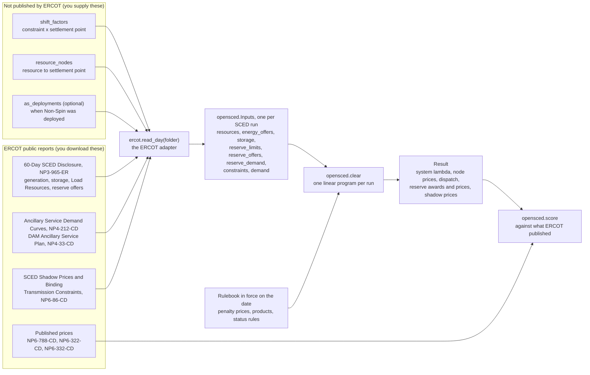

# How data feeds the engine

This repository holds the engine only. It ships no market data: you download ERCOT's public reports yourself, put one
operating day in a folder, and point the engine at it.

## The three layers

| Layer | What it is | Where it is defined |
|---|---|---|
| Market files | ERCOT's reports, in ERCOT's own column names | [ercot.md](ercot.md), "The files" |
| Input tables | A handful of plain pandas tables, the same for every market | [schema.md](schema.md), or `opensced.schema()` |
| Rulebook | The numbers and switches of the clearing, by date | [rules.md](rules.md) |

The adapter turns the first layer into the second. Nothing else in the engine knows about ERCOT's files, so a forecast
replaces any input table with its own numbers and clears the same way.

## Which report fills which table

| Input table | ERCOT report | File name in the day's folder |
|---|---|---|
| `resources`, `energy_offers` | 60-Day SCED Disclosure, generation resources (NP3-965-ER) | `60_sced_gen_res_data` |
| `resources`, `energy_offers`, `storage` | 60-Day SCED Disclosure, storage resources (NP3-965-ER) | `60d_sced_esr_data` |
| `resources` (Load Resources), `reserve_limits` | 60-Day SCED Disclosure, Load Resources (NP3-965-ER) | `60_load_res_data_in_sced` |
| `reserve_offers` | 60-Day SCED Disclosure, reserve offers (NP3-965-ER) | `60d_sced_resource_as_offers` |
| `reserve_demand` | Ancillary Service Demand Curves (NP4-212-CD) | `dam_sced_as_demand_curves` |
| `reserve_requirements` | DAM Ancillary Service Plan (NP4-33-CD) | `dam_as_plan` |
| `constraints` | SCED Shadow Prices and Binding Transmission Constraints (NP6-86-CD) | `shdw_prices_bnd_trns_const` |
| `demand` | Sum of the run's base points in the disclosure | (derived) |
| `shift_factors` | On ERCOT's secure site only. See below | yours |
| `resource_nodes` | Not public as one table | yours |
| Scoring only: node prices | LMPs by Resource Node, Load Zone and Hub (NP6-788-CD) | `lmp_node_zone_hub` |
| Scoring only: system lambda | SCED System Lambda (NP6-322-CD) | `sced_system_lambda` |
| Scoring only: reserve prices | Real-Time Clearing Prices for Capacity by SCED Interval (NP6-332-CD) | `rt_clear_price_cap_sced` |

Optional files, each for one known data problem, are described in [ercot.md](ercot.md): `as_deployments`,
`2day_agg_sced_as_offers`, `reference_sced_resource_as_offers`.

Each file holds one operating day, as `.parquet`, `.csv` or `.csv.gz`, with ERCOT's column names left as they are.
The 60-day disclosure is posted 60 days after the operating day, so a replay is possible for days at least that old.
The disclosure comes from ERCOT's website with no account; by then the other reports are only on ERCOT's public API,
which needs a free account. [ercot.md](ercot.md#getting-the-files) has the steps.

## Shift factors

ERCOT calculates shift factors for every SCED run and posts them only to its secure Market Information System, which
needs an ERCOT digital certificate: SCED Settlement Point Shift Factors (NP6-607-CD) and SCED Resource Shift Factors
(SYS-608-CD), kept for 31 days. Approved rule changes (NPRR1239, NPRR1249) move them to the public website once ERCOT
implements them.

The engine takes them as a table, constraint x settlement point, with rows labelled as [ercot.md](ercot.md)
describes. This package does not ship or estimate shift factors.
